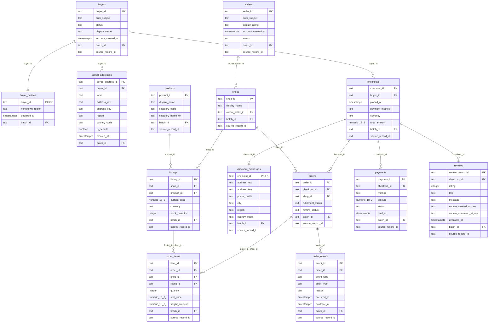
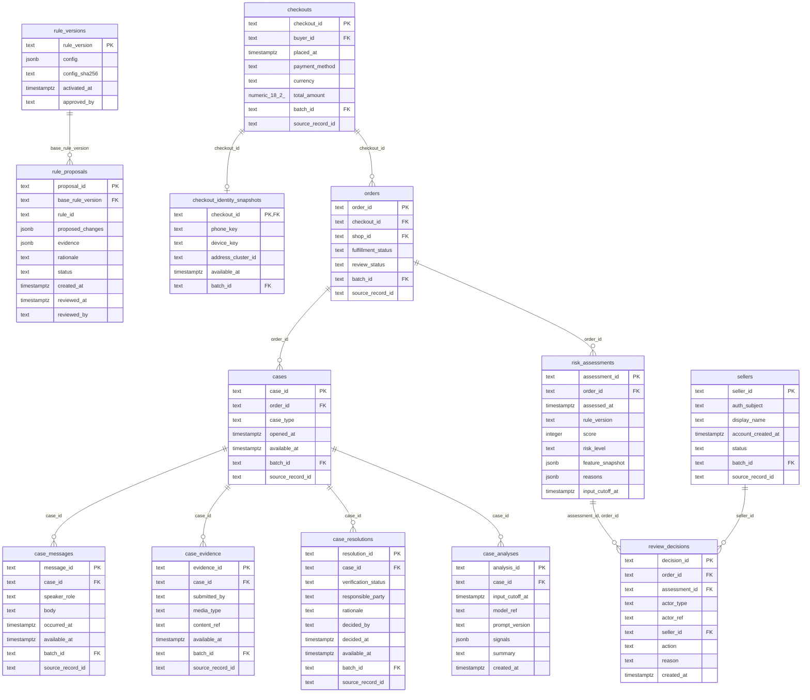

# ERD cho BE/FE và điểm nối với AI

Bản thiết kế để review và dựng database; không chứa dataset demo. DDL trong schema.sql là nguồn chuẩn. Các cạnh là FK đã khai báo; trường token phone/device không phải FK sang bảng nguồn có thật.

Ký hiệu: `||` đúng một; `o{` không hoặc nhiều; `o|` không hoặc một. Quan hệ một chiều FK không bắt buộc parent phải có child; service phải tạo snapshot và ít nhất một item khi checkout.

## Luồng nghiệp vụ

Buyer → checkout nhiều shop → một order mỗi shop → chấm điểm → Hold/Release → đóng gói/giao. Payment và review Olist ở cấp checkout, không nhân bản qua shop.

## 01_platform

## 02_risk_and_kbs

## Provenance và các quan hệ cần lưu ý

- `data_batches` nối tới mọi bảng có batch_id; xem ERD_full.mmd để có toàn bộ cạnh. Mỗi batch ghi nguồn và is_synthetic.
- `risk_assessments.rule_version` hiện là tham chiếu logic tới rule_versions.rule_version, chưa có FK SQL; backend phải kiểm phiên bản tồn tại. Đánh dấu rõ để BE chốt constraint trước migration.
- `review_decisions` dùng FK ghép (assessment_id, order_id), `order_items` dùng FK ghép để bảo đảm đúng shop. Sơ đồ không thay thế các CHECK/UNIQUE trong SQL.
- Những bảng shared giữa hai hình là cùng một bảng, không tạo hai bản.
- Seller và buyer là hai entity riêng. sellers → shops qua owner_seller_id NOT NULL; buyers → checkouts. Hai portal/auth subject được resolve theo loại tài khoản, không dùng buyer_id để thao tác seller.
- Giới hạn platform: đã thiết kế tài khoản nhưng chưa triển khai auth, variant SKU, nhiều kiện, settlement/refund ledger. Một seller có thể sở hữu nhiều shop; chưa có staff hoặc đồng sở hữu.
- Schema giữ phần mở rộng AI để thấy dependency. BE có thể ưu tiên module platform và assessment/decision; agent analysis, rule proposal làm sau. Không cần quyết định GraphRAG để tạo core database.
