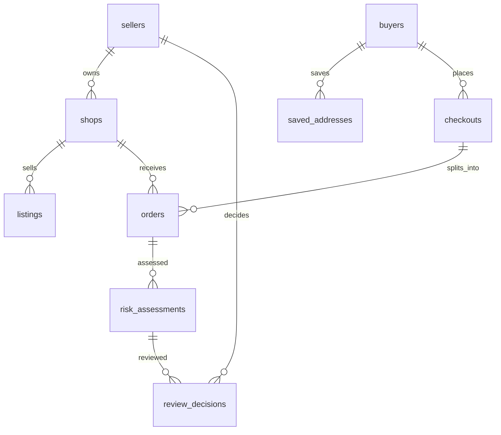

# Platform v2: seller và buyer riêng

## Tài khoản và quyền

`sellers` là tài khoản người bán; `buyers` là tài khoản người mua; `shops` là gian hàng, không phải tài khoản. Không có bảng users dùng chung trong model này.

Mỗi shop có đúng một owner_seller_id, seller có thể có nhiều shop. Một người muốn mua lẫn bán có hai hồ sơ riêng; không suy quyền seller từ buyer. Staff/đồng sở hữu chưa thuộc prototype.

Cả hai bảng có auth_subject UNIQUE (tham chiếu hệ thống xác thực), status active/suspended. auth_subject có thể null cho bản ghi lịch sử nhập từ nguồn; tài khoản được phép đăng nhập phải có subject đã xác thực. Không lưu mật khẩu dạng rõ hoặc coi email/ID client gửi là bằng chứng đăng nhập. Nhà cung cấp auth chưa được chọn/triển khai.

## Seller portal — giao diện chính của đề tài

| Trang / route đề xuất | Dữ liệu | Hành động |
|---|---|---|
| `/seller/login` | sellers.auth_subject/status | Đăng nhập vào portal seller |
| `/seller/shops` | shops.owner_seller_id | Tạo/chọn shop do seller sở hữu |
| `/seller/dashboard` | orders, risk_assessments, review_decisions theo shop | Tổng đơn cần đánh giá/Hold, mức rủi ro; số liệu từ DB, không bịa KPI tiết kiệm |
| `/seller/products` | shops → listings → products | Tạo listing, sửa giá/tồn kho; giữ snapshot giá của đơn cũ |
| `/seller/orders` | orders + checkouts + items + assessment | Lọc Pending/Hold/Released, mức rủi ro, trạng thái fulfillment |
| `/seller/orders/:id` | items, địa chỉ đơn, timeline, assessment | Xem lý do, dữ kiện, phiên bản rule và trạng thái thanh toán cần thiết |
| Chi tiết đơn — kiểm tra rủi ro | assessment + review_decisions | Release hoặc Keep Hold, ghi seller_id, lý do và assessment_id |
| Chi tiết đơn — fulfillment | orders + order_events | Chuẩn bị/giao theo state machine, chỉ sau released và đủ điều kiện thanh toán |
| `/seller/cases/:id` | case/messages/evidence/resolutions có quyền | Xem hồ sơ, gửi thông tin/bằng chứng; seller không tự xác minh mình hoặc buyer có lỗi |

Phần giải thích/điều tra AI có thể gắn vào chi tiết đơn sau; không chặn việc build UI seller và luồng Hold/Release. Đề xuất sửa rule toàn nền tảng thuộc quản trị, không cho mỗi seller tự áp dụng qua UI này.

## Buyer portal — luồng mua hàng

| Trang / route đề xuất | Dữ liệu | Hành động |
|---|---|---|
| `/buyer/login` | buyers.auth_subject/status | Đăng nhập buyer riêng |
| Catalog / shop detail | shops, listings, products | Xem/chọn hàng; cart có thể giữ client/session, chưa có bảng cart |
| `/buyer/addresses` | saved_addresses của buyer | Thêm/sửa địa chỉ, chọn mặc định |
| `/buyer/checkout` | checkouts/address snapshot/orders/items/payments | Xác nhận địa chỉ, thanh toán, đặt đơn theo nhiều shop |
| `/buyer/orders` và `/:id` | order thuộc checkout của buyer | Theo dõi tiến trình, yêu cầu hủy theo điều kiện nghiệp vụ |
| Hồ sơ hậu mãi | cases/messages/evidence | Gửi phản ánh; không tự tạo kết luận verified |

Buyer không thấy risk score, dữ liệu liên shop hoặc nút Hold/Release. Đơn chờ kiểm tra hiển thị thông báo trung tính như “Đơn đang được xác nhận”; không gắn nhãn khách gian lận. Quê khác địa chỉ nhận không tự tăng điểm.

## Contract BE cho hai portal

1. Server xác minh session và loại tài khoản; seller endpoint resolve seller_id, buyer endpoint resolve buyer_id. Frontend route guard chỉ hỗ trợ UX, không thay authorization ở server.
2. Seller chọn shop_id nhưng server luôn kiểm `shops.owner_seller_id = authenticated_seller_id`; cả API đọc và ghi đều cần kiểm. Không dùng shop_id từ request như quyền có sẵn.
3. Buyer đọc đơn qua `orders → checkouts.buyer_id`; địa chỉ cũng kiểm buyer_id, không nhận ID bất kỳ.
4. Hold/Release ghi `review_decisions.seller_id` FK sellers; actor_ref bằng seller_id với seller action. Server kiểm seller sở hữu shop của order; FK đơn lẻ không kiểm ownership này. Policy action có seller_id null.
5. Release/Keep Hold + audit + update gate phải atomic, chống thao tác từ assessment cũ. Không Hold lại đơn đã shipped. Suspended seller không được đổi dữ liệu.
6. Seller quản lý listings của shop mình. Product catalog chia sẻ không được sửa để ảnh hưởng shop khác; backend phải kiểm quyền sở hữu nội dung hoặc tạo product riêng cho listing mới.
7. Seller chỉ nhận dữ liệu thanh toán liên quan đơn mình; không lộ payment/tổng mua hàng của các shop khác cùng checkout. Dữ liệu liên shop phục vụ risk chỉ trả tổng hợp có kiểm soát.

Đây là thiết kế màn hình và contract để FE/BE triển khai, chưa phải giao diện hoặc API đã code.
